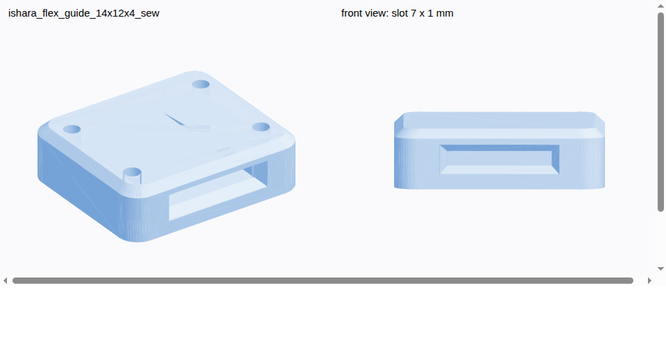
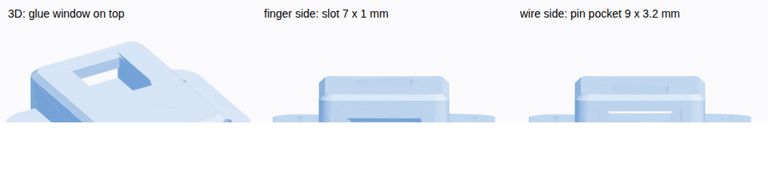

# Flex sensor guide

A 3D-printed guide that holds a flex sensor on the back of a finger while letting it slide as the finger bends. About 3 per finger.

| | |
|---|---|
| Outside | 14 mm wide × 12 mm long (along the finger) × 4 mm high, rounded corners |
| Slot | 7.0 × 1.0 mm through the whole length, 1.5 mm floor and roof. Flex sensor: 6.35 × 0.43 mm |
| Slot entries | flared to 8 × 2 mm over 0.8 mm, so the sensor's edges don't rub on a sharp corner |
| `_sew` version | 4 × 1.2 mm holes in the side walls for sewing it to the glove |

**Printing:** PLA or PETG (resin if available, for an accurate slot), 100 % infill, printed standing on an end face (slot vertical) so the slot needs no support. Print one first and check the sensor slides; if the slot comes out tight, regenerate with `SLOT_W, SLOT_H = 7.3, 1.3`.

**Regenerate:** `python make_holder.py .` (needs `manifold3d`, `trimesh` and `numpy`). Every size is a constant at the top of the script; the length is in the `for L in (12.0,)` loop.

# Anchor (base holder at the pins)

Holds the sensor's connector end fixed on the back of the hand, before the knuckle, so the sensor slides in the finger guides while its pins don't move. One per finger.

| | |
|---|---|
| Body | 14 mm wide × 20 mm long × 5.5 mm high, on a 24 × 16 × 1.5 mm flange |
| Slot (finger side, 8 mm) | 7.0 × 1.0 mm for the sensor's stiff end, flared entry |
| Pin pocket (wire side, 12 mm) | 9.0 × 3.2 mm for the 2 crimp pins, solder joints and heat shrink, open at the back for the wires |
| Window | 6 × 7 mm in the roof over the pocket: check the joints don't touch, then fill the pocket with hot glue so bending pulls on the holder, not on the pins |
| Holes | 4 × 1.2 mm in the flange, for sewing it to the glove |

The pin pocket size is from the sensor's typical crimp size, not measured on our sensors; measure the end with its solder joints and heat shrink before printing, and change `POCKET_W` / `POCKET_Z1` if needed.

**Printing:** flat on the flange, no support (the widest bridge is 9 mm), 100 % infill. 5 plus 2 spares.

**Regenerate:** `python make_anchor.py .`
